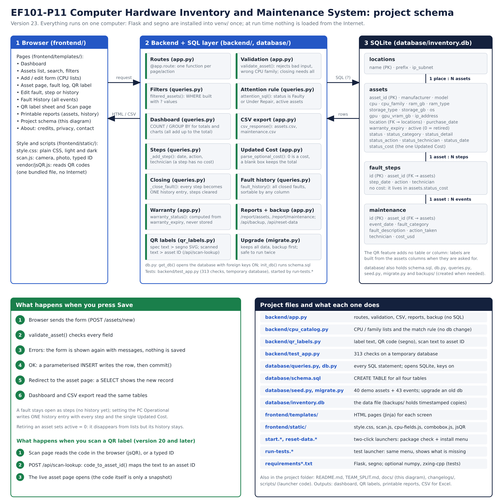

# EF101-P11 Computer Hardware Inventory and Maintenance System

> # **Project History Notice:** 
> ## For all project history and commits prior to **November 9, 2026** (v18 and earlier), please visit the first legacy repository: [AbdurRauf-01/ef101-p11](https://github.com/AbdurRauf-01/ef101-p11).
> ## For all project history and commits on **November 9, 2026** (v19), please visit the second legacy repository: [irtazaraza7184/ef101-p11](https://github.com/irtazaraza7184/ef101-p11).

Flask + SQLite web app that tracks computer assets (specs, location, warranty, status) and their maintenance/fault history, with a dashboard and CSV export. All data in `database/inventory.db` is **DEMO data**, not real assets.

## Submission details

| Item | Details |
| --- | --- |
| Project ID and title | EF101-P11, Computer Hardware Inventory and Maintenance System |
| Section and group | Section C, Group 11 |
| Team members | Irteza Raza (EE-26129), Abdur Rauf (EE-26138), Hassan Majid (EE-26125) |
| Software, platform and tools | Python 3.8+, Flask, segno, SQLite, Jinja2 templates, plain CSS, jsQR (bundled) |
| Running the project | Locally on your own computer. Run `start.bat` (Windows), `start.command` (macOS) or `start.sh` (Linux). The launcher opens the app in your browser at `http://127.0.0.1`. Full steps are in the sections below. |
| Login or demo credentials | None required. The app has no login and no user roles. |
| Hosted online | No. The project runs locally only. |
| Database and data | SQLite file `database/inventory.db` in the project folder, with synthetic demo data. No online database or service is used. |

## Project schema


## Dependencies

Everything the app needs, with the official website for each. The launchers install the Python packages for you; the rest is listed so you know what is being used.

**Required (installed by you or the launcher)**

| Dependency | Used for | Official website |
| --- | --- | --- |
| Python 3.8 or newer | Runs the whole app | https://www.python.org |
| pip | Installs the packages in `requirements.txt` | https://pip.pypa.io |
| venv (part of Python) | Creates the `venv/` folder | https://docs.python.org/3/library/venv.html |
| Flask (`>=2.2`) | Web framework | https://flask.palletsprojects.com |
| segno (`>=1.5`) | Draws QR codes as SVG | https://segno.readthedocs.io |
| SQLite (built into Python as `sqlite3`) | The database file `database/inventory.db` | https://www.sqlite.org |

**Installed automatically with Flask**

| Dependency | Official website |
| --- | --- |
| Werkzeug | https://werkzeug.palletsprojects.com |
| Jinja2 (templates) | https://jinja.palletsprojects.com |
| itsdangerous | https://itsdangerous.palletsprojects.com |
| click | https://click.palletsprojects.com |
| blinker | https://blinker.readthedocs.io |
| MarkupSafe | https://pypi.org/project/MarkupSafe/ |

**Bundled in the project (nothing to install)**

| Dependency | Used for | Official website |
| --- | --- | --- |
| jsQR (Apache-2.0) | Reads QR codes in the browser (`frontend/static/vendor/jsQR.js`) | https://github.com/cozmo/jsQR |

**Needed for the setup steps**

| Dependency | Used for | Official website |
| --- | --- | --- |
| git | Cloning the project | https://git-scm.com |
| GitHub | Hosts the repository | https://github.com |
| winget (Windows) | Installs Python in the launcher | https://learn.microsoft.com/windows/package-manager/winget/ |
| Homebrew (macOS) | Installs Python in the launcher | https://brew.sh |
| apt (Ubuntu) | Installs `python3-venv`, `python3-pip` and `git` | https://ubuntu.com |
| dnf (Fedora) | Installs Python and pip | https://fedoraproject.org |
| PowerShell (Windows) | The `Activate.ps1` and `Set-ExecutionPolicy` steps | https://learn.microsoft.com/powershell/ |

**Optional**

| Dependency | Used for | Official website |
| --- | --- | --- |
| Modern browser (Chrome, Edge or Firefox) | Using the app, camera scanning, Save as PDF on reports | https://www.google.com/chrome · https://www.microsoft.com/edge · https://www.mozilla.org/firefox |
| zxing-cpp | Extra QR decoding check in `backend/test_app.py` | https://github.com/zxing-cpp/zxing-cpp |
| OpenCV (`cv2`) | Alternative QR decoding check in `backend/test_app.py` | https://opencv.org |
| numpy | Used by the QR decoding check in `backend/test_app.py` | https://numpy.org |

## Run

**Two-click launch** (checks Python and the packages; if something is missing it asks before installing. The first launch may need internet, because Flask and segno are not part of Python and are downloaded when they are not already installed):

|  | Start the app | Reset or delete the data | Run the tests |
| --- | --- | --- | --- |
| Windows | `start.bat` | `reset-data.bat` | `run-tests.bat` |
| macOS | `start.command` | `reset-data.command` | `run-tests.command` |
| Fedora / Ubuntu | `start.sh` | `reset-data.sh` | `run-tests.sh` |

Double-click the file (Linux: if your file manager only opens it in an editor, run `./start.sh` in a terminal, or set the file manager to "Run in terminal"). The app opens in your browser.

If a copy lost its executable bit (ZIP files and some copies do), give the file you double-click permission once. Linux:

```
chmod +x start.sh reset-data.sh run-tests.sh
```

macOS:

```
chmod +x *.command
```

Only the file you double-click needs it: `start.sh` runs `scripts/bootstrap.sh` through `bash` and reopens itself in a terminal the same way, so `scripts/bootstrap.sh` needs no `chmod`.

What the launcher does: finds Python 3.8+ and checks that Flask and segno can be imported, either from `venv/` or from the system-wide Python. **If everything is there it starts `backend/app.py` straight away** (no question, no internet). If something is missing it shows what, gives the official download links, and asks:

1. **Install the dependencies automatically into `venv/`** (default, press Enter). Needs internet. Python itself is installed per user when it is missing (winget or python.org on Windows, Homebrew or python.org on macOS, dnf on Fedora, apt on Ubuntu; the Linux and macOS package managers ask for your password). Flask and segno go into `venv/` only.
2. **Install them yourself, system-wide.** The launcher shows the official pages (https://www.python.org/downloads/ and https://pypi.org/project/Flask/, https://pypi.org/project/segno/) and the exact `pip install --user` command for your Python, then asks **Y/N**: **Y** checks again and launches, **N** goes back to the menu.
3. **Continue anyway.** Runs with what is installed; it may stop with an error (for example `No module named flask`).
4. **Exit.** Nothing is installed.

Choices 1 and 2 are the opt-in system-wide path: **`venv/` is optional.** If Flask and segno are installed in your own Python, the launcher uses that Python and never creates `venv/`. The venv only keeps the project's packages apart from the system's; it is the default because it needs no administrator rights and cannot clash with other programs.

How the risk is kept low: the launcher never asks for administrator rights itself; the system-wide route (2) downloads nothing and only shows official links and a per-user (`--user`) command; Windows Python is installed for the current user only, after its download is checked for the Python Software Foundation signature (macOS: the package signature); packages are installed with `--only-binary`, so no package can run build scripts; and the install is never started without your choice. `LAUNCHER_CHOICE=1` to `4` in the environment picks a menu choice for you (scripted use), and with no keyboard attached the package menu and the Linux / macOS Python menu install nothing (in the Windows Python menu, Enter or no input means choice 1).

Later launches skip every step that is already done. `venv/` can be deleted at any time; choice 1 rebuilds it. Manual run: see "Manual run (no launcher)" below.

**Reset or delete the data** (`reset-data.*`) shows two choices:

1. **Reset to demo data:** replaces everything with the 40 demo assets and their fault history.
2. **Delete all data:** removes every asset, fault, repair step and maintenance record and leaves an empty database with the six standard places, ready for your own assets.

Press Enter to cancel. When the database holds assets it asks you to type YES first, and it always saves the current data as `database/backups/inventory.before-reset-<date>.db` (or `before-delete-`) inside the project folder before changing anything. Options for scripted use (for example `bash scripts/bootstrap.sh reset --empty --yes`): `--demo` picks choice 1, `--empty` picks choice 2, `--yes` skips the YES question (alone it means choice 1). Choice 1 does the same as `python database/seed.py`. The app prints its address (http://127.0.0.1:5000, or the next free port if 5000 is busy) and the location of its data file.

- **Your data is kept in this folder**, in `database/inventory.db`. Launching never deletes it. To move the project, move the whole folder, data included.
- **First launch:** an empty database is created with the six standard places. Add assets from the app.
- **Demo data (optional):** this replaces the data with 40 demo assets. It asks you to type YES first when there is data:

  ```
  python database/seed.py
  ```
- **Several copies at once:** each copy has its own data file and its own address, so you can run an older version (for example v7) next to this one to compare.
- **Tests:** `run-tests.bat` / `run-tests.command` / `run-tests.sh`, or this command inside the venv, runs every check (313 in version 23) on a temporary database and prints a results table. Your data is never touched.

  ```
  python backend/test_app.py
  ```
  - **Dependency check:** the `run-tests.*` script looks for the packages the tests use in `venv/` and in the system-wide Python. If all are there the tests simply run. If any are missing it lists them, warns how many tests would fail or be skipped, shows the official links and shows the same four-choice menu as the launcher (1 install into `venv/`, default; 2 install yourself, system-wide; 3 continue anyway; 4 exit). Choice 3 runs the tests with what is installed, and the end of the run says what was left out. `--yes` is the same as choice 1 and `--no-install` the same as choice 3, for example:

    ```
    bash scripts/bootstrap.sh test --no-install
    ```

  - **How many tests depend on which package** (measured by running the suite with each package removed):

    | Package | Tests that depend on it | Without it |
    | --- | --- | --- |
    | Flask (`requirements.txt`) | all 313 | the test script cannot run |
    | segno (`requirements.txt`) | 10 | 9 tests fail (QR label page, label sheet, QR image, asset page QR card) and the QR decode test is not run, so the run ends `303/312` |
    | numpy + zxing-cpp, or numpy + OpenCV (`requirements-test.txt`, optional) | 1 (the QR decode check) | that test is not run; the run ends `312/312` |

    The other 303 tests need nothing beyond Flask and the Python standard library.

### Windows Smart App Control blocks the launchers

Smart App Control (Windows 11) blocks scripts such as the `.bat` launchers when they come from the Internet, with no "run anyway" button, and Microsoft documents no way to allow a single app. Skip the launchers: a command you type is not a downloaded file, and `python.exe` from python.org is signed, so the "Manual run" steps below work. Activating the venv is optional, so once it exists you can also run the app straight from it:

```
venv\Scripts\python.exe backend\app.py
```

Flask and segno are pure Python (no compiled files). The optional test packages numpy and zxing-cpp contain compiled files that may not be signed; if Smart App Control reports "part of this app has been blocked" for them, the tests still run without them (`312/312`; choice 3 in the menu).

## Manual run (no launcher)

Use this to open the project by hand after getting it from GitHub (main branch), or if the two-click launcher does not work on your computer. These steps are for **Windows** and **macOS**; Linux has its own section below. All commands are typed in a terminal opened **inside the project folder** (the folder that contains `backend/app.py`).

> **macOS:** this project was **not tested on macOS**, because we do not have a Mac, and it was built with AI assistance. If an error occurs on a Mac, please [open an issue](https://github.com/AbdurRauf-01/ef101-fall2026-p11/issues) and let us know.

1. **Get the project.** Either:
   - **Clone.** `git clone` puts the project in the folder your terminal is currently in, so first go to the Downloads folder. Windows (Command Prompt):

     ```
     cd %USERPROFILE%\Downloads
     ```

     macOS:

     ```
     cd ~/Downloads
     ```

     Then clone (this creates the folder `ef101-fall2026-p11` inside Downloads):

     ```
     git clone https://github.com/AbdurRauf-01/ef101-fall2026-p11.git
     ```

   - **Download ZIP:** on the GitHub page of the repository (main branch) click Code, then Download ZIP, and extract it. The extracted folder is usually named `ef101-fall2026-p11-main`, in your Downloads folder.

   `database/inventory.db` (the demo data) comes with the project. The `venv/` folder does not, so you create it in step 4.
2. **Install Python 3.8 or newer** (https://www.python.org/downloads/; on Windows tick "Add python.exe to PATH" in the installer). Check it. Windows:

   ```
   python --version
   ```

   macOS:

   ```
   python3 --version
   ```
3. **Open a terminal in the project folder.** If you cloned in step 1, you are one `cd` away. Windows (Command Prompt), clone:

   ```
   cd %USERPROFILE%\Downloads\ef101-fall2026-p11
   ```

   Windows, ZIP (the folder name ends in `-main`):

   ```
   cd %USERPROFILE%\Downloads\ef101-fall2026-p11-main
   ```

   macOS, clone:

   ```
   cd ~/Downloads/ef101-fall2026-p11
   ```

   macOS, ZIP:

   ```
   cd ~/Downloads/ef101-fall2026-p11-main
   ```

   (Windows alternative: open the folder in File Explorer, click the address bar, type `cmd`, press Enter.) Check you are in the right place: you should see `backend` in the list. Windows: `dir`; macOS: `ls`.
4. **Create the virtual environment** (once only; this makes the `venv/` folder). Windows:

   ```
   python -m venv venv
   ```

   macOS:

   ```
   python3 -m venv venv
   ```
5. **Activate it** (every time you open a new terminal). Windows (Command Prompt):

   ```
   venv\Scripts\activate.bat
   ```

   Windows (PowerShell):

   ```
   venv\Scripts\Activate.ps1
   ```

   macOS:

   ```
   source venv/bin/activate
   ```

   The prompt now starts with `(venv)`. If PowerShell says scripts are disabled, run this once in that window and activate again (or use Command Prompt instead):

   ```
   Set-ExecutionPolicy -Scope Process -ExecutionPolicy Bypass
   ```

   (This only changes that one window; it does not lower any system setting. It does not help with Smart App Control, see above.)
6. **Install the packages** (once only, needs internet):

   ```
   pip install -r requirements.txt
   ```
7. **Optional, data:** the shipped `database/inventory.db` already holds the demo data. To reset it to the demo data, run this (it asks you to type YES):

   ```
   python database/seed.py
   ```

   If you copied in a `database/inventory.db` from an older version, run this first:

   ```
   python database/migrate.py
   ```
8. **Start the app:**

   ```
   python backend/app.py
   ```

   To choose the port:

   ```
   python backend/app.py --port 8000
   ```
9. **Open the address it prints** in your browser, normally http://127.0.0.1:5000 (the next free port if 5000 is busy). Use the address shown in your own terminal.
10. **Stop the app** with `Ctrl+C` in the terminal. Leave the virtual environment with `deactivate`.
11. **Run the tests (optional):** with the venv still active:

    ```
    python backend/test_app.py
    ```

    It uses a temporary database, so your data is not touched, and must end with `313/313 passed` (`312/312` if the optional numpy and zxing-cpp or OpenCV packages are not installed; see the table under *Tests* above).

Next time you only need steps 3, 5 and 8: open the terminal in the folder, activate the venv, run `python backend/app.py`. To get later changes from GitHub, run this in the project folder (clone) or download the ZIP again (keep your own `database/inventory.db` if you want to keep your data):

```
git pull
```

Common problems: `python` not found (on macOS use `python3`; on Windows try `py`, or reinstall Python with PATH ticked); `No module named flask` (the venv is not active, or step 6 was skipped); `venv` was copied from another computer or another operating system (delete the `venv/` folder and repeat steps 4 to 6); "Address already in use" (the app picks the next free port by itself, or choose one with `--port`).

### Manual run on Linux (Ubuntu and Fedora): all commands in one place

Open a terminal (Ubuntu: Ctrl+Alt+T; Fedora: search for "Terminal"). Do step A once, then B to D.

**A. Install the tools (once).**

Ubuntu / Debian:

```
sudo apt update && sudo apt install -y git python3 python3-venv python3-pip
```

Fedora:

```
sudo dnf install -y git python3 python3-pip
```

Fedora's `python3` already includes `venv`. Check the version (3.8 or newer):

```
python3 --version
```

**B. Get the project (once).** Either clone it. `git clone` puts the project in the folder your terminal is in, so go to Downloads first:

```
cd ~/Downloads
git clone https://github.com/AbdurRauf-01/ef101-fall2026-p11.git
cd ef101-fall2026-p11
```

or download the ZIP of the main branch from GitHub and extract it, then `cd` into the folder:

```
unzip ef101-fall2026-p11-main.zip
cd ~/Downloads/ef101-fall2026-p11-main
```

(or right-click, Extract, and in the file manager right-click inside the folder and choose "Open in Terminal"). Check with `ls` that you can see `backend/app.py`.

**C. Create the virtual environment and install Flask (once).**

```
python3 -m venv venv
source venv/bin/activate
pip install -r requirements.txt
```

**D. Start the app (every time).**

```
cd ef101-fall2026-p11         # or ef101-fall2026-p11-main, the project folder
source venv/bin/activate      # the prompt now starts with (venv)
python backend/app.py
```

Open the printed address (normally http://127.0.0.1:5000) in the browser, or open it from a second terminal:

```
xdg-open http://127.0.0.1:5000
```

Stop with `Ctrl+C`, then `deactivate`.

Linux notes:
- Inside the activated venv, `python` and `pip` work (the venv provides them). Outside it, use `python3`.
- `The virtual environment was not created successfully` or `ensurepip is not available` on Ubuntu: `python3-venv` is missing; run the Ubuntu command in step A, delete the half-made folder, and repeat step C:

  ```
  rm -rf venv
  ```

- `error: externally-managed-environment` when running pip: you are outside the venv. Run `source venv/bin/activate` first; do not use `--break-system-packages`.
- `command not found: git`: install it as in step A, or use the ZIP download instead.
- Optional: reset the data to the demo data (type YES), and run the 313 checks:

  ```
  python database/seed.py
  python backend/test_app.py
  ```
- If a double-click launcher does not run, give the file you double-click permission once, then double-click it or run `./start.sh`. `scripts/bootstrap.sh` needs no `chmod`. This manual route does not need any of it.

  ```
  chmod +x start.sh reset-data.sh run-tests.sh
  ```

## Files

**Project layout**

```
backend/     app.py (Flask routes), cpu_catalog.py (CPU and family lists and match check), qr_labels.py (QR text and codes), test_app.py (tests)
database/    inventory.db, schema.sql, db.py, queries.py (all SQL), seed.py, migrate.py, backups/ (created when needed)
frontend/    templates/ (HTML pages), static/ (CSS, scan.js, cpu-fields.js, combobox.js, bundled jsQR)
scripts/     launcher code used by the start / reset / test files in the project folder
docs/  changelogs/  README.md  TEAM_SPLIT.md  requirements*.txt  start.*  reset-data.*  run-tests.*
```

| File | Purpose |
| --- | --- |
| `start.*`, `reset-data.*`, `run-tests.*`, `scripts/` | Launchers per OS: dependency check, four-choice install menu (venv, system-wide, continue, exit), start, demo reset, tests (nothing is installed without asking) |
| `requirements.txt` | Python packages the app needs (Flask, segno) |
| `requirements-test.txt` | Optional packages used only by `backend/test_app.py` (numpy, zxing-cpp) |
| `backend/app.py` | Backend: routes, input validation, CSV export, printable reports, backup (no SQL) |
| `backend/cpu_catalog.py` | The finite list of CPU families, a list of common CPU models (suggestions only), the pattern rules that read the family out of a CPU name, and the check that a CPU belongs to its family |
| `backend/qr_labels.py` | The spec text stored in a label, the QR code itself (SVG, made with segno) and the rule that turns a scanned text into an asset ID |
| `database/queries.py` | Database layer: every SQL statement (filters, saves, dashboard figures) |
| `database/db.py` | SQLite connection + schema creation |
| `database/schema.sql` | The four tables: `locations`, `assets`, `fault_steps` (steps of an open fault) and `maintenance` (history) |
| `database/seed.py` | Demo data generator (fixed random seed, reproducible) |
| `database/migrate.py` | Upgrades an older `database/inventory.db` to the current version without losing data (backup kept, safe to run twice) |
| `changelogs/` | Version history: `changelogs/v23.md` (what changed in version 23), `changelogs/v22.md`, `changelogs/v21.md`, `changelogs/v20.md` and older |
| `backend/test_app.py` | Test evidence (add, edit, retire, invalid input, duplicates, filters, history, dashboard, export) |
| `frontend/templates/`, `frontend/static/` | HTML (Jinja) pages and the stylesheet; `frontend/static/cpu-fields.js` fills the CPU family on the Add / Edit form, `frontend/static/combobox.js` draws its type-to-filter lists, `frontend/static/scan.js` is the Scan page script and `frontend/static/vendor/jsQR.js` the bundled QR reader (Apache-2.0, licence beside it) |
| `frontend/templates/report_assets.html` | Standalone printable asset inventory report (no base.html, `@media print` CSS) |
| `frontend/templates/report_maintenance.html` | Standalone printable maintenance/fault history report |
| `database/backups/` | Timestamped database backups — created automatically on reset or when *Backup data* is clicked |

## Upgrading an existing database

Only needed if you already have a `database/inventory.db` from an older version. This version ships with its own up-to-date `database/inventory.db`, so a fresh copy needs nothing.

Run this once (or add the path to your database after it):

```
python database/migrate.py
python database/migrate.py path/to/inventory.db
```

It keeps a backup as `inventory.db.bak` first, checks the new database (row counts, integrity, foreign keys) before replacing the old one, and does nothing if the database is already up to date (running it twice is safe).

- **From version 14-15.x** (the database already has `fault_steps`): everything is kept exactly as it is: assets, places and their range numbers, IP addresses, history, and the steps of open faults. The only change is that steps no longer carry a cost. The cost of an open fault stays on the asset as its single Updated Cost (if an open fault had none, the cost of its last step becomes the Updated Cost). Old steps that only held a cost (no action) are removed.
- **From version 8-13** (no `fault_steps` table): incomplete history entries (a blank or Unknown field) are removed, valid entries logged while a fault was open become its steps, invalid or repeated IP addresses are left as Not Assigned, and everything removed or changed is listed on screen.

## How it works

- **Cost**: A single *Updated Cost* ($) box is used across all forms. Rather than adding up a price for every step, the person entering data controls the current total directly. When a fault is closed to Operational, the final maintenance history entry records this Updated Cost. A typed `0` is a real cost of 0 and is saved as 0 (on the Edit form and on the Log form); a blank box keeps the current total.
- **Editable records**: To fix grammatical mistakes or typos, all items in *Maintenance history*, *Current fault*, and open fault steps can be edited directly.
- **Asset IDs**: Auto-generated from the chosen location (e.g. `L1-PC-041`) if not manually entered. The user can enter a custom Asset ID or simply select the place to have the next available ID assigned automatically.
- **GPU VRAM**: The GPU VRAM input is dynamically displayed only when a dedicated GPU is entered. For machines with integrated graphics (blank GPU), the VRAM field is hidden.
- **Fault history page** (sidebar: Fault History): lists every closed fault of every asset, newest first by default. Click a column heading to sort by it (click again to reverse); the Status heading cycles which status comes first.
- **IP addresses**: optional. The Add/Edit form suggests one from the Asset ID and the place's range: `192.168.{range}.{last two digits of the ID number}` (for example L1-PC-041 in Lab 1 gives 192.168.1.41). The suggestion updates when the ID or place changes. Typing an IP switches to Custom mode, and *Reset to Auto* returns to the suggestion. A blank IP is shown as Not Assigned. Two PCs in the same place can never share an IP (checked on save): if a suggestion repeats one, the save is refused with a message and the IP must be changed. Different places may share one.
- **Needs attention** (active assets only): status is Faulty or Under Repair, and nothing else. Past fault events are listed separately on the Fault History page, whatever the status.
- **Current fault**: while a PC is Faulty or Under Repair, its fault (category, description, actions to be taken, technician, date, updated cost) is shown in its Current fault section. Nothing is written to the history while the fault is open. Under Repair requires a technician. A blank category is saved as Unknown.
- **Steps of an open fault**: each save with a new action adds an audit step (its date, action and technician). A step has no cost of its own: the cost of the open fault is the single Updated Cost, so correcting the cost changes the total and adds no step. The steps are listed under Current fault.
- **Closing a fault**: the PC is closed by setting it to Operational. Every fault field (category other than Unknown, description, action taken, technician) and the date are required; the cost is optional. The fault is then written to the history as ONE entry: its Action taken lists every step with its date, and its cost is the single Updated Cost.
- **Sorting**: the asset list sorts by any column (click a heading; click again to reverse). The Status heading cycles which status comes first: Operational (green), Under Repair (yellow), Faulty (red); the other statuses follow alphabetically. The default is Asset ID, ascending.
- **Fault categories**: maintenance events use a fixed drop-down (Disk failure, Overheating, Network issue, RAM fault, OS corruption, Display issue, PSU failure, Other, Unknown). The failure chart always shows every category; anything unexpected is counted as Other.
- **Locations**: a place is chosen from a drop-down, or added with **+ Add new location** (it then appears on the dashboard, even while empty). Each place has a short code (for example Lab 4 = `L4`).
- **CPU and CPU family** (version 23): both boxes are text boxes with a drop-down list that narrows as you type (about 240 common CPU models and 40 families, Intel, AMD, Apple and Qualcomm, desktop and laptop). Picking or typing a CPU fills the family. The two must match: `Intel Core i5-12400` with family `Core i3` is rejected with a message, both in the browser hint and on Save. Any other CPU model can still be typed, because the family is read from the name by rules (so new models match without an update). A CPU the rules do not recognise must use the family `Other`. No database change.
- **RAM type**: DDR1 to DDR5 drop-down, required for every asset (12th to 14th gen Intel CPUs can take DDR4 or DDR5, so the type is recorded per machine).
- **Dashboard charts** are computed from the same active-asset query as the totals, so the charts always add up to the total.
- **Warranty label**: `WARRANTY_SOON_DAYS` (30) at the top of `database/queries.py` sets the Expiring soon window.
- **Warranty status** is computed from `warranty_expiry` (Active / Expiring soon / Expired), never stored.
- **Retire** sets `active = 0`; the row and its history are kept. Reactivate reverses it.
- **Validation**: required fields, RAM/storage positive integers, valid IP, valid dates (always stored as YYYY-MM-DD, whatever format was typed), purchase date not in the future, warranty not before purchase, duplicate asset ID rejected (upper/lower case ignored), asset ID of letters, digits, `-` `.` `_` only (max 40), costs finite and between 0 and 1,000,000,000, a text box holds at most 500 characters, a location name at most 40.
- **Local-only protections**: the app answers only to `127.0.0.1` / `localhost` (set `INVENTORY_ALLOWED_HOSTS` to add a name), refuses form posts sent from another website, and sends a Content-Security-Policy so the browser loads nothing from the internet. Debug mode is off; start with `FLASK_DEBUG=1` only when developing.
- **QR labels and scanning** (bonus, version 20): every asset has a QR code holding a short plain-text block of its specs (asset ID, model, CPU, RAM, storage, GPU, OS, IP, location, warranty expiry) and its status with an *as of* date. Any phone camera shows that text with no network, so the specs can be read even though the app runs only on this computer. The text is a snapshot: after a spec or status change the label must be printed again (the printed date shows its age); the asset page in the app is always current. Fault details and costs are never put on a label. The asset page shows the code with *Print label* and *Download SVG*; *QR Labels* in the sidebar (or the *QR labels* button on the Assets list, which keeps the current search and filters) opens a printable sheet of labels (QR, ID, model, place, warranty, printed date). The *Scan QR* page reads a label with the camera, from an uploaded photo, or from the text box (a USB barcode scanner types into it), asks the app which asset the text means (`/api/scan-lookup`; the spec block, an older link, `EF101-ASSET:<ID>` or a bare ID are all understood, upper/lower case ignored) and opens it. Reading happens in the browser, nothing is sent anywhere else. The camera needs `http://127.0.0.1` or `localhost`. The app answers only to 127.0.0.1 and localhost unless `INVENTORY_ALLOWED_HOSTS` is set, so a phone cannot open the app itself; it reads the specs from the code instead. If `segno` is missing the label pages show an install hint and every other page still works.
- **Exports**: CSV cells that start with `=` `+` `-` `@` get a leading apostrophe so Excel/Calc cannot run them as formulas; files carry a UTF-8 byte-order mark so accents open correctly.
- **Printable reports** (version 21): `/report/assets` and `/report/maintenance` serve standalone HTML pages with `@media print` CSS. They follow the same filters and sort as the main list pages. The *Print / Save PDF* browser button renders the report; there is no server-side PDF. Linked from the sidebar and from *Print Report* buttons on the Assets and Fault History pages.
- **Backup** (version 21): The *Backup data* button in the sidebar saves a timestamped copy of `database/inventory.db` to the `database/backups/` folder without resetting anything. The sidebar's *Reset data* button (version 23: a dialog with *Reset to demo data* and *Delete all data*, confirmed by typing YES) and the `reset-data.*` scripts also save a backup to `database/backups/` before changing anything. Backups are plain SQLite files and can be restored by renaming one back to `database/inventory.db`.
- **Old databases**: starting the app on a `database/inventory.db` from an older version stops with a message to run `python database/migrate.py`.
- All SQL uses `?` placeholders (no string-built values), so search input cannot inject SQL.

## Tool and AI disclosure

**Software:** Python, Flask, SQLite (built-in `sqlite3`), Jinja templates and plain CSS. The QR codes are drawn by the Python package `segno` (BSD) and read in the browser by `jsQR` (Apache-2.0, one file bundled in `frontend/static/vendor/`, so nothing is loaded from the Internet at run time; `segno` is installed from the Python package index with the other requirements). No font, script or image is loaded from the Internet. No external data or assets are used; the demo data is generated by `database/seed.py`.

**AI:** Claude (Anthropic) drafted the application code, demo-data script, test script and report skeleton, and improved and fixed later versions (up to 23) through several Claude accounts. Version 19 (9 Nov 2026, Irteza Raza and Abdur Rauf with Claude) changed the interface; reviews on 12, 13 and 14 Nov 2026 fixed further errors. Figures 3 to 5 are cropped screenshots of the running app (demo database, 12 Nov 2026; the pages are the same in version 23).

**Who did what** (same as report section 9):

| Member | Main area | Contribution |
| --- | --- | --- |
| Irteza Raza (EE-26129) | Database: `database/schema.sql`, `database/db.py`, `database/queries.py`, `database/seed.py`, `database/inventory.db` | Built the database files using Claude. Fixed IP address handling, current-fault editing, maintenance history management and the Fault History table using Claude. Added the GPU VRAM field and the Delete and Edit buttons in maintenance history using Claude. Built the v19 interface from Hassan Majid's ideas using Claude. |
| Abdur Rauf (EE-26138) | Backend: `backend/app.py`, `backend/cpu_catalog.py`, `backend/qr_labels.py`, `backend/test_app.py`, `database/migrate.py`, launcher scripts, README | Built these files and the interface using Claude. Fixed the major asset editing error (see the report, section 5), cost logic, dates, asset IDs, RAM types, dashboard sorting, the asset editing page and unused code using Claude. Added the theme, sidebar, Credits, Privacy Policy, Contact, Fault History and Current fault field using Claude. Built the v19 interface from Hassan Majid's ideas using Claude. Added the v20 QR labels, label sheet, scanner page and short-link routes (`backend/qr_labels.py`, `frontend/static/scan.js`), and v21 printable reports (`/report/assets`, `/report/maintenance`) and the backups/ system using Claude. In v22 he sorted the code into the backend/, database/ and frontend/ folders, added the run-tests launchers and redrew the project diagram using Claude. In v23, he added CPU list and linked CPU family with the CPUs using Claude. Uploaded the project to Google Classroom. Recorded a demo video in Fedora KDE Linux (two parts, about 10 minutes). |
| Hassan Majid (EE-26125) | Frontend design (ideas); final report | Proposed the interface design ideas: theme, sidebar, sidebar sections and assets list sorting. Ideas only, no code; Irteza Raza and Abdur Rauf built them in v19. Optional: video recording. Answers the frontend viva questions. |

## Limitations

No login or user roles; data entry is manual; SQLite suits one site and few concurrent users; demo data is synthetic.
